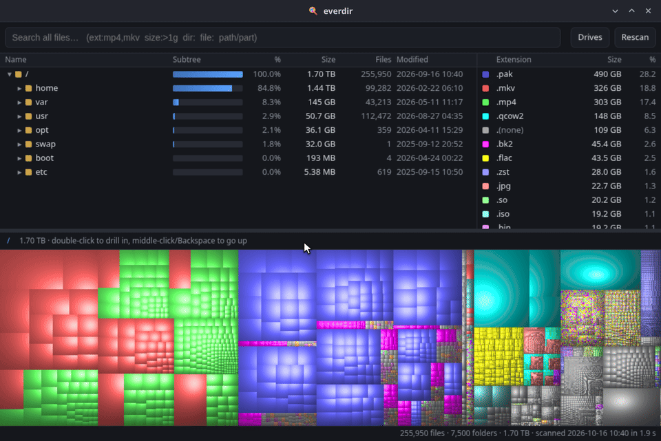
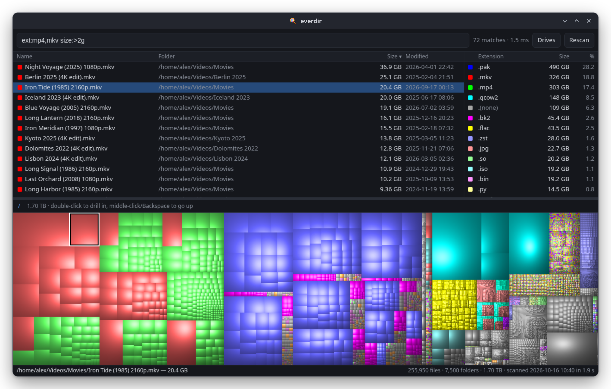
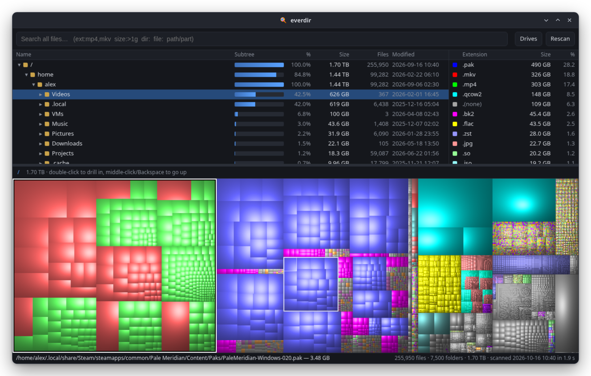

<div align="center">


# everdir

**Find any file on your disk instantly, and see what's using the space.**

[](LICENSE)
[](https://www.rust-lang.org/)
[](#requirements)



</div>

## Why

On Windows I relied on two tools: [Everything](https://www.voidtools.com/), for finding any file by name
the moment you type it, and [WinDirStat](https://windirstat.net/), for seeing where the disk space
went. I never found anything on Linux that felt the same, so I wrote everdir for myself. It ended up
fast enough, and covering enough of what I need, that I thought I'd share it.

everdir indexes the whole disk into memory and runs as a systemd user service (a launchd agent on
macOS), either from login or only while you use it. Its UI is a local web page at `http://127.0.0.1:7171`, with a tray icon (Linux) and a terminal search command alongside.

## Features

| | |
|---|---|
| **Instant search** | Results update as you type, matching any part of a name. Filter by extension, size, file or folder, and path. Sort by name, size or date. |
| **Cushion treemap** | A WinDirStat-style treemap with one colour per file type. Hover over a block to see its path, click it to find it in the tree, double-click to drill in. |
| **Size tree** | Folders sorted by size on disk, with percentage bars, file counts and modification dates. Symlinks are not followed, and hardlinked or reflinked data (`cp` clones on XFS, btrfs and bcachefs) is counted once. Each drive also shows how full its filesystem is. |
| **File types** | Space used by each extension. Click one to highlight its files in the treemap, double-click to list them by size. |
| **Several drives** | `/` is always indexed. Other partitions and disks, network shares (SMB, NFS, sshfs and others), and any folder you add can be indexed too, each with its own rescan schedule, and hidden from the views when you don't want them. Any drive can be limited to the folders you choose instead of all of it. |
| **Ready at startup** | The index is cached on disk (lz4), so it's available right away after a reboot. Rescans run on a schedule or when you ask for one. |
| **File actions** | Open, show in the file manager, copy the path, move to the Trash or delete permanently. Deleting always asks first. |
| **Keyboard friendly** | `Ctrl+F` / `/` to search, arrows and `Enter` to move around and open, `Del` to trash, `Z` to zoom the treemap, `Backspace` to go up, `F5` to rescan. |
| **Tray and CLI** | On Linux a tray icon opens the UI, starts a rescan, toggles start at login, or quits. `everdir <query>` searches from the terminal, and `everdir quit` stops the daemon. |

<table>
  <tr>
    <td>2g, sorted by size"></td>
    <td></td>
  </tr>
  <tr>
    <td align="center"><sub>Search with filters: <code>ext:mp4,mkv size:&gt;2g</code>, sorted by size</sub></td>
    <td align="center"><sub>Size tree, file types and the cushion treemap</sub></td>
  </tr>
</table>

## Performance

Measured on my desktop (AMD Ryzen 9 5900X, two NVMe SSDs and one 3 TB hard disk) with three drives
indexed:

| | |
|---|---|
| Index size | 4.4 million files and 670,000 folders, 1.6 TiB on disk |
| Name and extension searches (`ext:rs`, `.so`, `readme`, `size:>1g`) | 2–9 ms on the server, about 4–12 ms round trip |
| Worst case: a single letter matching 2.6 million files | about 135 ms |
| Path searches (a term containing `/`) | about 100 ms |
| Rescan of both NVMe drives (3.5 million files, warm cache) | under 1 second |
| Rescan of the hard disk (0.9 million files) | about 25 seconds |
| Daemon memory (RSS) | about 440 MB for 5.1 million files and folders, roughly 90 bytes each |

Memory grows with the number of files: a typical desktop with 500,000 files needs about 50 MB.
Loading or rebuilding the index briefly takes about twice as much. If you'd rather not keep it in
memory at all, turn off start at login (see below).

Search time is the median of nine runs, as reported by the daemon. Scans walk directories in
parallel, and the service runs at low CPU and idle I/O priority so rescans don't get in your way.

## Requirements

- Linux x86_64. The prebuilt release needs glibc 2.34+ (Arch, CachyOS, Fedora, Debian 12+, Ubuntu 22.04+).
  Building from source needs Rust 1.88 or newer; no C libraries are needed.
- A systemd user session for the service. Without one, run `everdir serve` yourself.
- macOS 11 or newer, Apple silicon or Intel. Grant `~/.local/bin/everdir` **Full Disk Access**
  (System Settings → Privacy & Security) or folders such as `~/Library/Mail` are skipped. There is
  no tray icon on macOS; use `everdir open` and `everdir quit`. Chrome or Chromium is used for the
  app window when installed, otherwise your default browser.

<details>
<summary>Optional runtime tools, per distribution</summary>

| Used for | Command | Arch | Debian/Ubuntu | Fedora |
|---|---|---|---|---|
| Move to Trash | `gio` | `glib2` | `libglib2.0-bin` | `glib2` |
| Open files, browser fallback | `xdg-open` | `xdg-utils` | `xdg-utils` | `xdg-utils` |
| Show in file manager | `dbus-send` | `dbus` | `dbus` | `dbus-tools` |
| App window (`everdir open`) | `google-chrome-stable`, `google-chrome`, `chromium` or `chromium-browser` | `chromium` (or `google-chrome` from the AUR) | `chromium` | `chromium` |
| Tray icon | a StatusNotifierItem host (KDE Plasma; GNOME needs the AppIndicator extension) | | | |

`install.sh` warns about any of these that are missing.

</details>

## Install

Prebuilt binary (no Rust needed):

```sh
curl -fsSL https://github.com/boisenme/everdir/releases/latest/download/everdir-x86_64-linux.tar.gz | tar xz
cd everdir && ./install.sh
```

On macOS, pick `everdir-aarch64-macos.tar.gz` (Apple silicon) or `everdir-x86_64-macos.tar.gz` (Intel):

```sh
curl -fsSL https://github.com/boisenme/everdir/releases/latest/download/everdir-aarch64-macos.tar.gz | tar xz
cd everdir && ./install.sh
```

Or build from source:

```sh
git clone https://github.com/boisenme/everdir.git && cd everdir
./install.sh
```

The script installs everdir for your user (no root) and starts the service. From a source
checkout it builds the binary first.
The first scan begins as soon as the daemon starts. Then open the UI from your app launcher, the
tray icon, or with `everdir open`.

**Run it only when you need it.** Untick **Start at login** in the tray menu (or run
`systemctl --user disable everdir`). everdir then starts when you open it from the launcher or with
`everdir open`, loads its cached index in about a second, and frees all its memory when you pick
**Quit** in the tray. Scheduled rescans only run while it's running.

<details>
<summary>What gets installed</summary>

- `~/.local/bin/everdir`
- `~/.config/systemd/user/everdir.service`, which the script enables and starts
- `~/.local/share/icons/hicolor/scalable/apps/everdir.svg`
- `~/.local/share/applications/everdir.desktop` and `chrome-everdir.localhost__-Default.desktop`
  (the second maps Chrome's app window to the everdir icon)

If no systemd user session is available, the script installs everything except the service and
prints how to start the daemon by hand.

On macOS it installs `~/.local/bin/everdir` and `~/Library/LaunchAgents/io.github.boisenme.everdir.plist`,
which starts the daemon at login and logs to `~/Library/Logs/everdir.log`. To stop starting at
login, run `launchctl bootout gui/$(id -u)/io.github.boisenme.everdir`; `everdir open` still starts it on demand.

</details>

## Usage

```
everdir [serve]      run the daemon (what the service runs)
everdir open         open the UI (starting the daemon if needed) as a Chrome/Chromium app window
everdir rescan       rescan all enabled drives now
everdir quit         stop the daemon and free its memory
everdir <query...>   search from the terminal and print matching paths (up to 500)
```

### Search syntax

Words are combined with AND, and matching ignores case. The terminal uses the same syntax as the UI.

| Term | Matches |
|---|---|
| `foo bar` | names that contain both `foo` and `bar` |
| `src/main` | a term that contains `/` is matched against the full path |
| `ext:mp4,mkv` | files with one of these extensions |
| `size:>1g`, `size:<10k` | size above or below a limit (`k`, `m`, `g`, `t` suffixes; binary units) |
| `dir:` or `folder:` | folders only |
| `file:` | files only |

```sh
everdir ext:iso size:'>1g'
```

## Configuration

| What | Where |
|---|---|
| Drive settings (on or off, rescan interval, chosen folders, added folders) | `$XDG_CONFIG_HOME/everdir/drives.json` (default `~/.config/everdir/`) |
| Scan cache, one file per drive | `$XDG_CACHE_HOME/everdir/` (default `~/.cache/everdir/`) |
| Port | `EVERDIR_PORT` environment variable (default `7171`) |
| Turn off the tray icon | set `EVERDIR_NO_TRAY` to any value |

Drives are managed in the UI under **Drives**. By default `/` is rescanned daily and other drives
weekly; you can choose hourly up to every 30 days, or only on request. `/proc`, `/sys`, `/dev`,
`/run`, `/tmp` and `/.snapshots` are never indexed. On macOS, `/dev`, `/System/Volumes` (the data
volume already appears under `/` through firmlinks) and `/private/var/vm` are skipped.

To index only part of a drive, click **Only some folders…** under it in **Drives** and type a path,
either absolute or relative to the drive (`Media` on `/mnt/cold` means `/mnt/cold/Media`). Only the
chosen folders are scanned. The folders above them show just the part that leads there, and are
marked *partly indexed*. everdir won't delete those, since it can't tell how much is really in them.

Network shares mounted on the system (including automounted ones such as `x-systemd.automount`
entries in fstab) are listed under **Drives** next to the disks, off until you turn them on.
everdir never asks a share for its free space, because that can hang when the server is gone. If a
scan can't read a share, it keeps the share's last scan, shows the error, and tries again an hour
later.

Below the list you can also add any folder as a drive of its own, for example one folder on a share
or a folder on a disk you don't want to index whole. The drive the folder sits on skips it from
then on, so nothing is counted twice. **Remove** stops indexing the folder on its own, and that
drive is rescanned to pick it up again.

To change the port for the service, run `systemctl --user edit everdir` and add:

```ini
[Service]
Environment=EVERDIR_PORT=7272
```

The CLI and `everdir open` read the same variable, so set it in your shell too.

## Uninstall

Run `./uninstall.sh` from the folder you installed from:

```sh
./uninstall.sh
```

This stops and disables the service and removes every installed file. Your settings and the scan
cache are kept, and the script prints where they are.

## Security

- The server listens on `127.0.0.1` only, so it can't be reached from the network.
- Requests must carry a `Host` header for `127.0.0.1`, `localhost` or `everdir.localhost` on the
  configured port, which blocks DNS-rebinding attacks. POST requests must also carry an
  `X-Everdir` header, which a cross-site form can't set. Together these stop websites open in your
  browser from reading the index or deleting files.
- **There is no authentication between local users.** On a machine with several users, any of
  them can connect to the port, search your index (file names and paths across the disk, including
  your home directory), and call the delete endpoint, which deletes with your permissions. Use
  everdir only on single-user machines, or where you trust every local user.

## Inspiration

everdir borrows its two big ideas from great Windows tools. If you're on Windows, use them:

- [**Everything**](https://www.voidtools.com/) by voidtools: instant file name search across the whole disk.
- [**WinDirStat**](https://windirstat.net/): the cushion treemap and per-extension colours. everdir
  uses WinDirStat's colour palette and cushion shading.

## License

[MIT](LICENSE)

## Check out snip

If you're on KDE Plasma, have a look at [**snip**](https://github.com/boisenme/snip), my ShareX-style
screenshot tool: pick a region or window, add markers and arrows, copy it, or grab the text with OCR.
